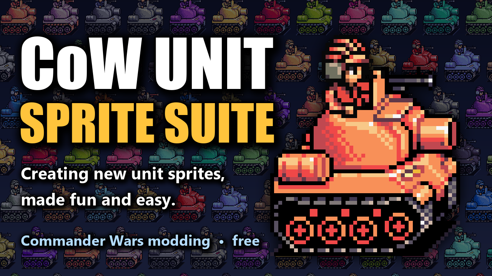
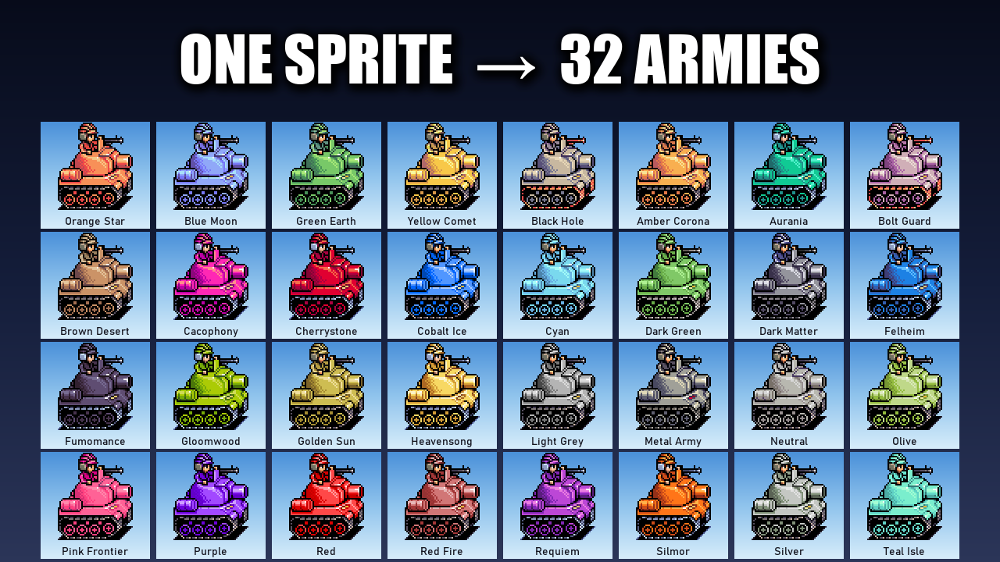
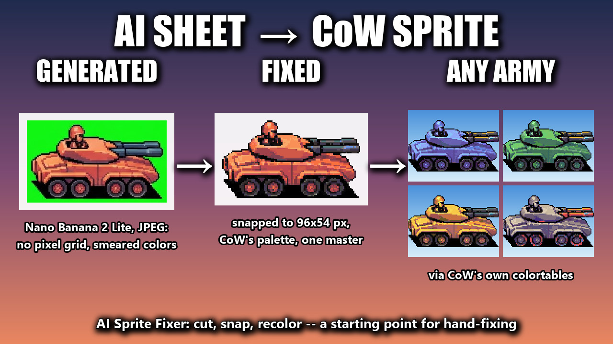

# CoW Unit Sprite Suite

### Get it here: https://reactorcore.itch.io/cow-unit-sprite-suite

## About

A free workflow toolkit for making new unit sprites for **[Commander Wars](https://commander-wars.pages.dev/)**, the open-source Advance Wars-style strategy game for PC.

Draw your units in plain Orange Star red, like the original games. The suite converts them into Commander Wars' mask format — the washed-out "ugly palette" the game's sprite files use, which is bizarre to draw in directly. The game then recolors that one file for every army.

## What it does

- **Converts your art** — draw units in Orange Star red on a green background, at any whole-number scale, one per image or many per sheet. The suite cuts them apart, finds each one's true pixel size, snaps the colors to the game's palette and encodes them into the mask format Commander Wars reads.
- **Previews your sprites in team colors** — check any mask sprite on four time-of-day backgrounds. As a bonus, flip through all 32 armies and export PNGs, whole sets or a collage to show your units off.
- **Gives you references** — 91 Advance Wars 2 units from all five armies, recolored to Orange Star red, plus the exact per-class palettes.
- **AI route, at battle-animation scale** — a wildcard generator rolls random vehicle ideas ("armored hovercraft vehicle with a twin flak cannon") and builds prompts for an image generator's edit mode, and the **AI Sprite Fixer** turns the sheet that comes back into real sprites: it cuts the units apart, snaps them to a clean pixel grid, puts them on the game's palette and encodes them, ready for all 32 armies. The results are a strong starting point for hand-fixing rather than finished art, and map-sized units still have to be drawn by hand.

Not only for Commander Wars: the wildcard generator works for any game that needs vehicle ideas, and its straight side, front and top views suit other art styles, from total-conversion mods to a game of your own. Its word lists are plain text files you can rewrite for any setting.

## Getting started

Windows only. Unzip anywhere and run **CoW Sprite Previewer.exe** — it opens on Commander Wars' own units so you can see it working straight away. No install, no Python needed.

Then read **[guide.md](guide.md)**. The quickstart at the top is four steps.

## What's included

- `CoW Sprite Previewer.exe` — preview, export, and convert (Cut sheet / Convert folder)
- `CoW Wildcard Generator.exe` — subject and prompt builder for the AI route
- `CoW AI Sprite Fixer.exe` — turns an AI-generated sheet into CoW sprites and army-colored PNGs
- `pipeline/` — reference images, palettes and prompt data
- `reference/colortables/` — Commander Wars' team colortables
- `wildcards/` — editable word lists for the generator
- `samples/` — Commander Wars' own sprites, for trying things out
- `guide.md` — how to use all of it

## Credits and license

This suite is free and open source by Reactorcore, under the **MIT License** — see `LICENSE.txt`. The license covers the suite's own code and docs, not the third-party material below.

The colortables in `reference/colortables/` and the sprites in `samples/` come from **Commander Wars** by Robosturm and contributors, licensed under the **GNU LGPL-3.0** — see `reference/Commander_Wars-LICENSE-LGPL-3.0.txt` and https://github.com/Robosturm/Commander_Wars. They are included unmodified so the tools can render sprites exactly as the game does.

The reference images in `pipeline/reference/` are derived from Advance Wars 2 sprites (© Nintendo / Intelligent Systems) and are provided as drawing references for fan modding only.

Advance Wars is a trademark of Nintendo. This project is not affiliated with or endorsed by Nintendo or the Commander Wars project.

## Contact

mailto:reactorcoregames@gmail.com

---

Check out everything else I do: ✨🚀

https://linktr.ee/reactorcore

https://reactorcore.itch.io/

-Reactorcore

---

My other links:

- Home/Links: https://linktr.ee/reactorcore
- Releases: https://reactorcore.itch.io
- Blog: https://www.patreon.com/ReactorcoreGames
- Discord: https://discord.gg/UdRavGhj47
- Catalog: https://reactorcoregames.github.io/
